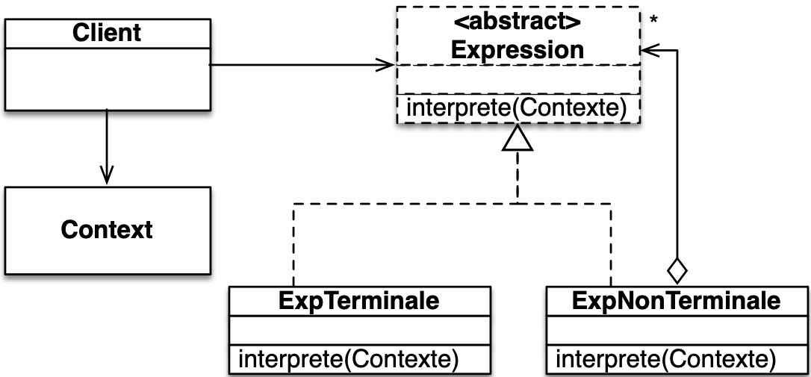

# Interpreter 

Le but du patern interpreter est de définir une grammaire pour un langage et d'implémenter un interpréteur qui peut exécuter des instructions dans ce langage.

Le diagramme de classes du pattern interpreter est le suivant :


Le package `composite` contient en réalité des classes qui représentent les différents éléments de la grammaire, tels que les expressions, les opérateurs et les instructions. Chaque classe implémente l'interface `Element`, qui définit une méthode `eval()` pour exécuter le calcul correspondant. 

Ce package propose donc une classe `Parser` qui permet de parser une expression mathématique et de construire un arbre d'expressions à partir de cette expression. L'arbre d'expressions est ensuite évalué en appelant la méthode `eval()` ou en passant un `visiteur` sur la racine de l'arbre.

## Objectif 
La syntaxe EBNF de la grammaire à implémenter est la suivante :

```
expression ::= terme { ("+" | "-") terme }
terme      ::= facteur { ("*" | "/") facteur }
facteur    ::= entier | "(" expression ")"
entier     ::= "0".."9" { "0".."9" }
```

Le fichier `Parser.java` contient déjà une implémentation partielle du parser, avec des méthodes pour analyser les expressions, les termes et les facteurs. Il vous reste à compléter l'implémentation des méthodes `parseExpression`, `parseTerme` et `parseFacteur` pour construire l'arbre d'expressions correspondant à la grammaire ci-dessus.

## Pour commencer :

> **Note :** Le fichier `Main.java` propose un ensemble d'appels au parser qui vous permettront de tester votre code à tout moment. Il produit déjà l'affichage des nombres entiers.

La méthode `parseEntier` est déjà implémentée et permet de parser un entier. 

Les méthodes de gestions d'erreurs ou de charactères sont déjà implémentées. 

#### Etape 1 : implémenter une grammaire beaucoup plus simple : 

Ciblez l'implémentation de la grammaire suivante, qui ne gère que les entiers et une adition:
```
expression ::= entier "+" entier
entier     ::= "0".."9" { "0".."9" }
```

#### Etape 2 : implémenter la grammaire simple 
Ciblez l'implémentation de la grammaire suivante, qui gère les entiers et les opérations d'addition et de soustraction:

```
expression ::= entier ("+" | "-") entier 
entier     ::= "0".."9" { "0".."9" }
```

#### Etape 3 : implémenter la grammaire 
Ciblez l'implémentation de la grammaire suivante, qui gère les entiers et les opérations d'addition et de soustraction multiples:

```
expression ::= entier { ("+" | "-") entier } 
entier     ::= "0".."9" { "0".."9" }
```

#### Etape 4 : implémenter la grammaire complète
Ciblez l'implémentation de la grammaire qui gère l'ensemble des opérations d'addition, de soustraction, de multiplication et de division, ainsi que les parenthèses pour la priorité des opérations:

```
expression ::= terme { ("+" | "-") terme }
terme      ::= facteur { ("*" | "/") facteur }
facteur    ::= entier | "(" expression ")"
entier     ::= "0".."9" { "0".."9" }
```